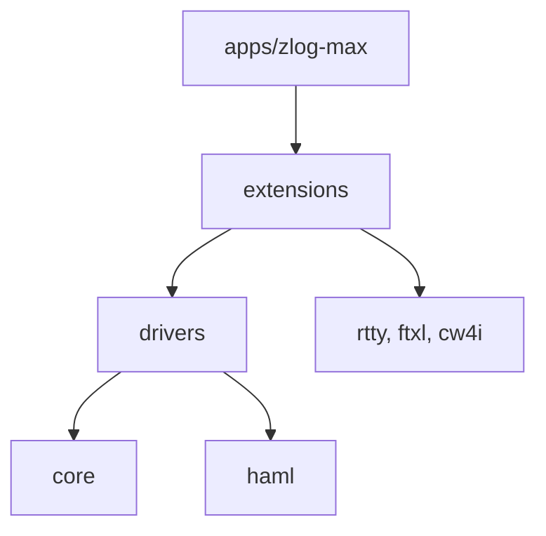
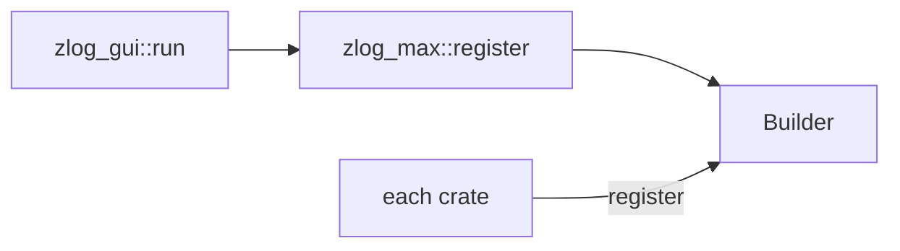
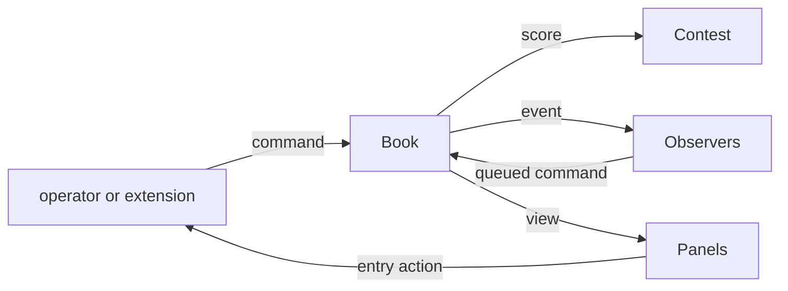
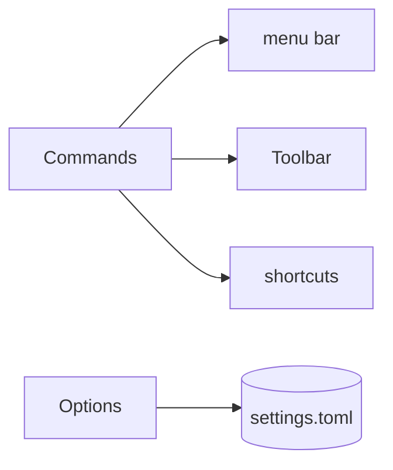
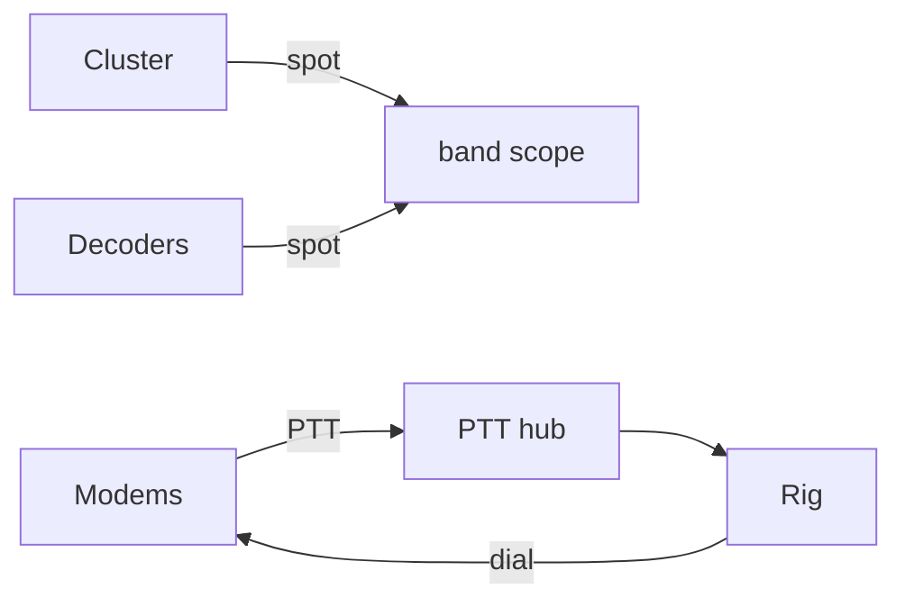
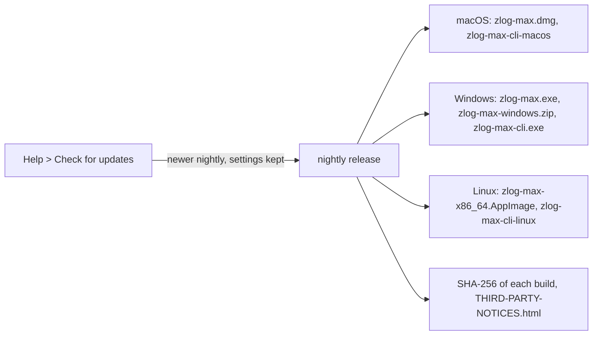
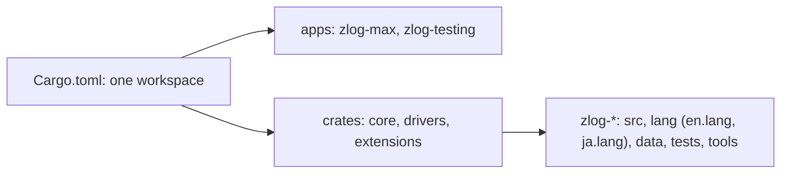
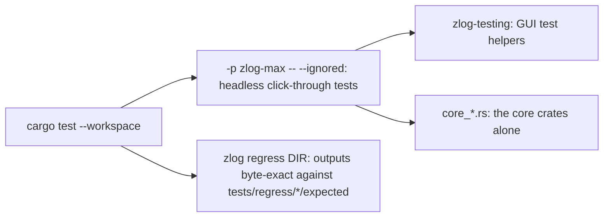
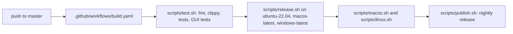

# zLog Max


The contest logger zLog in Rust for macOS, Windows and Linux, based on [jr8ppg/zLog](https://github.com/jr8ppg/zLog).
Every contest, file format, window and device is a crate linked at build time into one program.

## Architecture



| Layer | Contents |
|---|---|
| core | interfaces (zlog-core, zlog-ui), hosts (zlog-gui, zlog-cli), standard window parts (zlog-std) |
| drivers | rigs, keyers, SO2R, serial ports, remote, sound |
| extensions | contest rules, log formats, windows, digital modes, network services |

Dependencies point from extensions to drivers to core.
The test layers.rs of apps/zlog-max checks this from the folders.

Each crate has a `register` function that adds its parts to one `zlog_ui::Builder`.



### Log Changes

Every change to the log is a command, and every view of it is read only.



### Menus and Options

The menu bar, the toolbar and the shortcuts show one list of commands.
Each Options tab writes its own section of settings.toml.



### Devices and Band Scope

The cluster and the decoders send spots to the band scope.
The RTTY and FT modems key the rig through one PTT hub and follow its dial.



### Logs and Contests

| Crate | Role |
|---|---|
| zlog-qxsl | ADIF, Cabrillo, CTESTWIN, HAMLOG, JARL, QXML and zLog text through rxsl |
| zlog-summary | JARL E-Log and Cabrillo summary sheets |
| zlog-jarl | JARL Web submission |
| zlog-cfg | CFG and DAT contest definitions |
| zlog-lua | Luau scripts in a helper process |
| zlog-zylo | ZyLO plugins in a helper process |

The Lua API is in [crates/extensions/zlog-lua](crates/extensions/zlog-lua/README.md).

## Download



Builds of master are on the [nightly release](https://github.com/nextzlog/zmax/releases/tag/nightly).
On Linux, run `chmod +x` on the AppImage.
For serial devices on Linux, add the user to the `dialout` group.
The manual is at [use.zlog.org](https://use.zlog.org).

## Build

```sh
$ cargo build --release -p zlog-max
$ ./target/release/zlog-max
```



## Test

```sh
$ cargo test --workspace
$ cargo test --release -p zlog-max -- --ignored
```



## Release



## License

### Author

[無線部開発班](https://nextzlog.dev)

### Clauses

- [MIT License](LICENSE).
- Toolbar icons: [Phosphor Icons](https://phosphoricons.com) (MIT).
- 出典: 国土交通省国土数値情報
- Map background: © [OpenStreetMap](https://www.openstreetmap.org/copyright) contributors.
- Other licences: `THIRD-PARTY-NOTICES.html` in each release.
