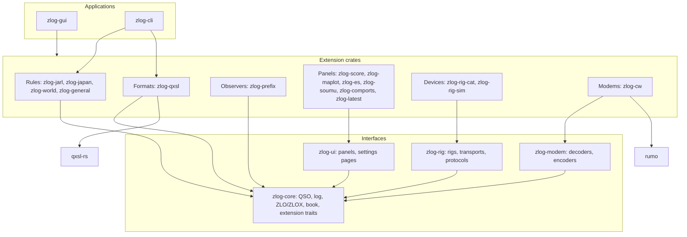
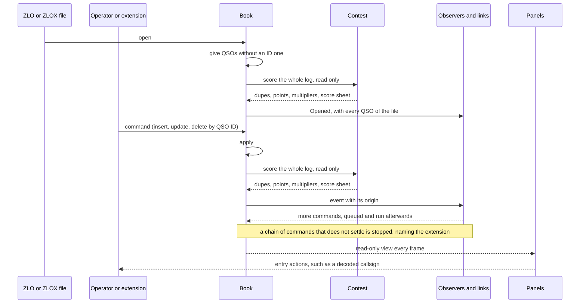
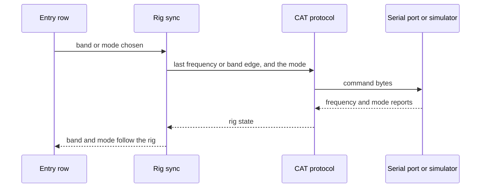

zlog-rs
====


zlog-rs is the contest logger [zLog](https://github.com/jr8ppg/zLog) rewritten in Rust for macOS and Windows.
Its core is small, and every contest, file format, window and device is an extension crate linked in at build time.

## Architecture

The core knows no contest, no screen and no device; everything else is an extension crate, and the application links the ones its build includes.





Rig control keeps the rig and the entry row in step both ways, with the same code for a real rig and the built-in simulator.



## Extensions

| Kind | Trait | Provides |
|---|---|---|
| Rules | `ContestDef`, `Contest` | A contest in the zLog Menu: sent number, number check, scoring, multiplier table. |
| Formats | `LogFormat` | Import and export of a file format. |
| Observers | `Observer` | Reactions to changes of the log. |
| Links | `Link` | An observer that also receives from outside, such as a network. |
| Panels | `zlog_ui::Panel` | A window of its own, listed in the Windows menu. |
| Settings | `zlog_ui::SettingsPage` | A page of the Options dialog over the extension's own section. |
| Devices | `zlog_rig::Protocol`, `zlog_rig::Transport` | Rig control. |
| Modems | `zlog_modem::Demodulator`, `zlog_modem::Modulator` | Decoding and sending CW and other modes. |

An extension crate exports one `Extension` bundling its rules, formats, observers and links, and the application lists the crates it links in `registry.rs`.

## Build

```sh
$ cargo build --release -p zlog-gui
$ ./target/release/zlog-gui
```

Each extension is a Cargo feature of `zlog-gui`, so a build with fewer extensions is chosen with `--no-default-features --features ...`.

## Test

```sh
$ cargo test --workspace
```

## License

### Author

[無線部開発班](https://nextzlog.dev)

### Clauses

- This software is released under the [MIT License](LICENSE).
- Data and code taken from other projects keep their own notices in the crates that use them.
