# zLog Max


The contest logger zLog in Rust for macOS, Windows and Linux, based on [jr8ppg/zLog](https://github.com/jr8ppg/zLog).
Every contest, file format, window and device is a crate linked at build time into one program.

## Architecture

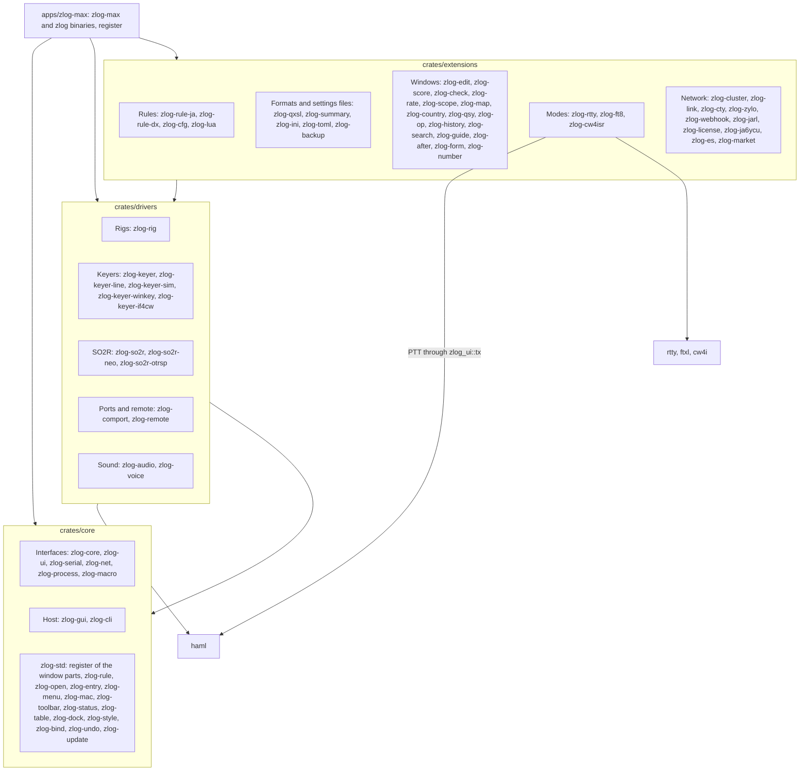

Dependencies point from extensions to drivers to core; the test layers.rs of apps/zlog-max checks this from the folders.

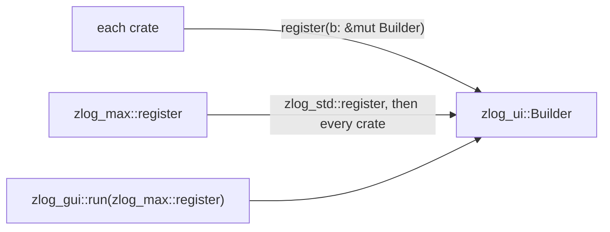

### Extensions

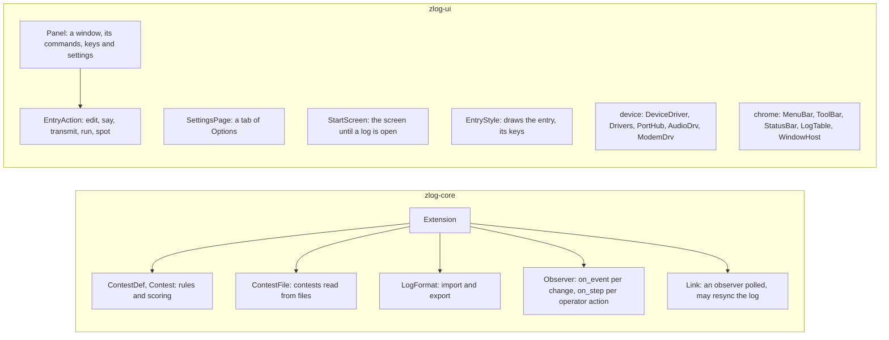

### Log Changes

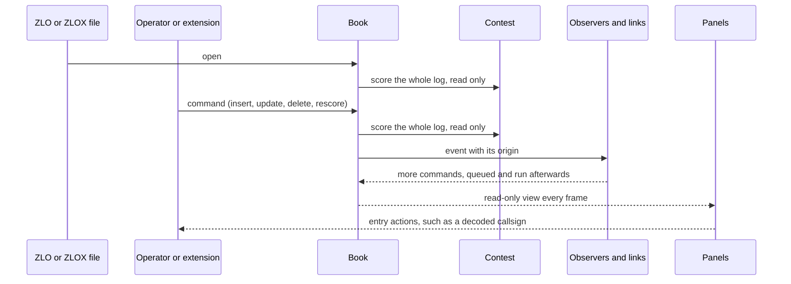

### Menus, Toolbar and Options

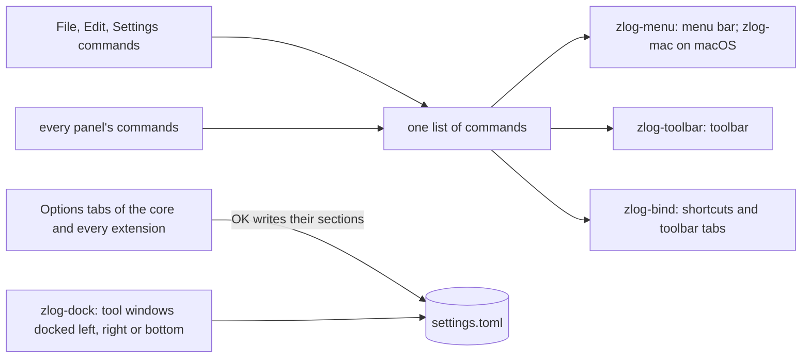

### Devices and Band Scope

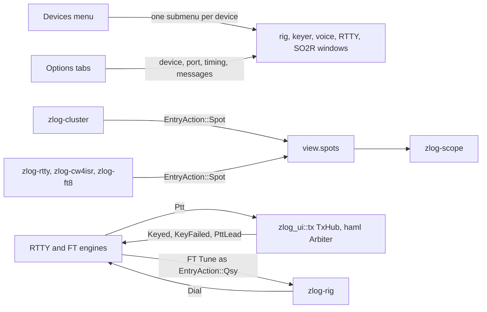

### Logs, Contests and Plugins

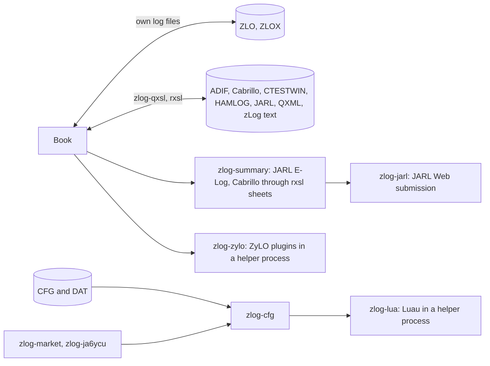

The Lua API is in [crates/extensions/zlog-lua](crates/extensions/zlog-lua/README.md).

## Download

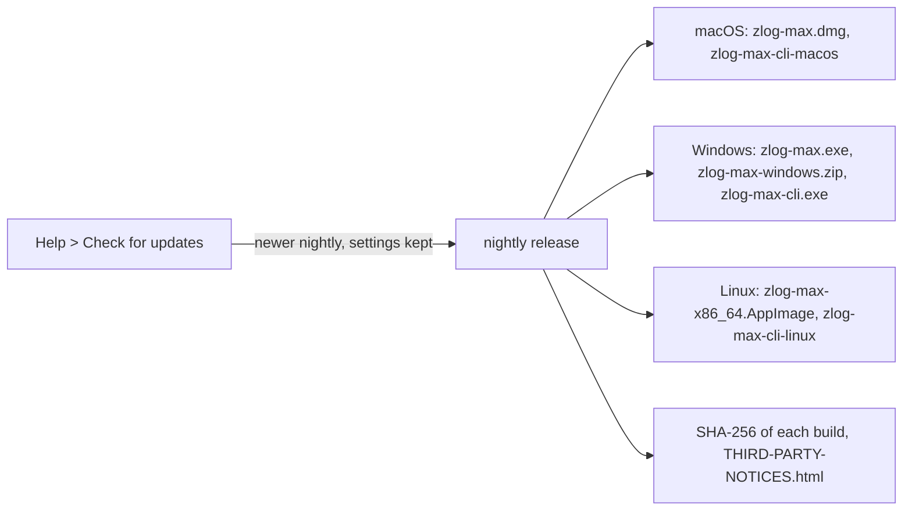

Builds of master are on the [nightly release](https://github.com/nextzlog/zmax/releases/tag/nightly).
On Linux, run `chmod +x` on the AppImage.
For serial devices on Linux, add the user to the `dialout` group.
The manual is at [use.zlog.org](https://use.zlog.org).

## Build

```sh
$ cargo build --release -p zlog-max
$ ./target/release/zlog-max
```

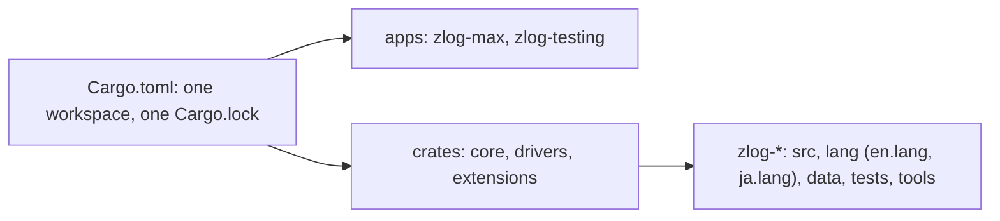

## Test

```sh
$ cargo test --workspace
$ cargo test --release -p zlog-max -- --ignored
```

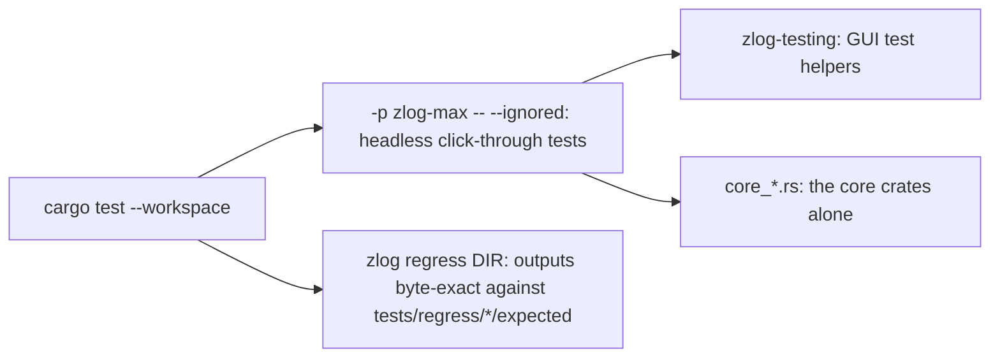

## Release

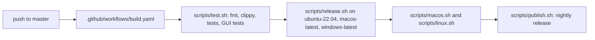

## License

### Author

[無線部開発班](https://nextzlog.dev)

### Clauses

- [MIT License](LICENSE).
- Toolbar icons: [Phosphor Icons](https://phosphoricons.com) (MIT).
- 出典: 国土交通省国土数値情報
- Map background: © [OpenStreetMap](https://www.openstreetmap.org/copyright) contributors.
- Other licences: `THIRD-PARTY-NOTICES.html` in each release.
