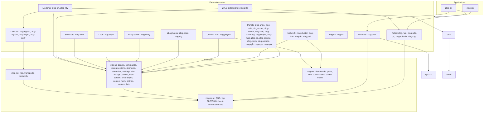
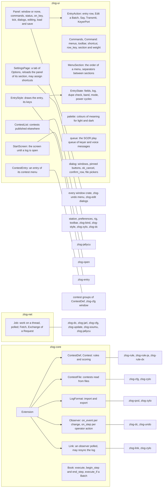
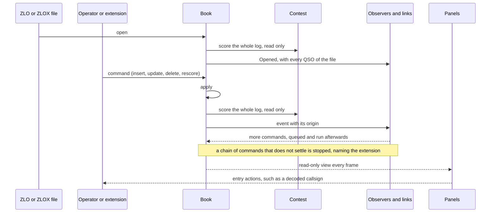
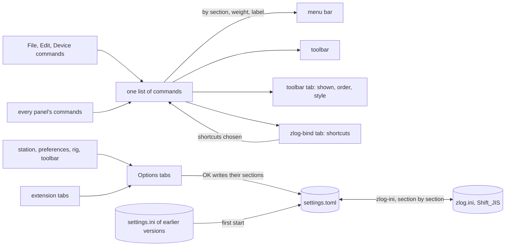
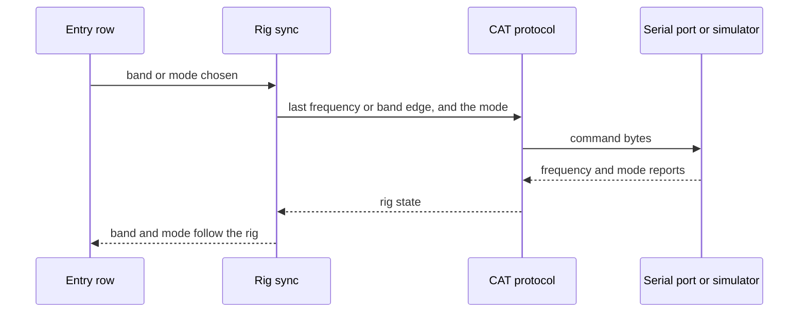
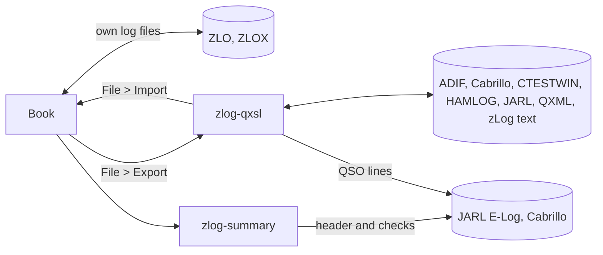
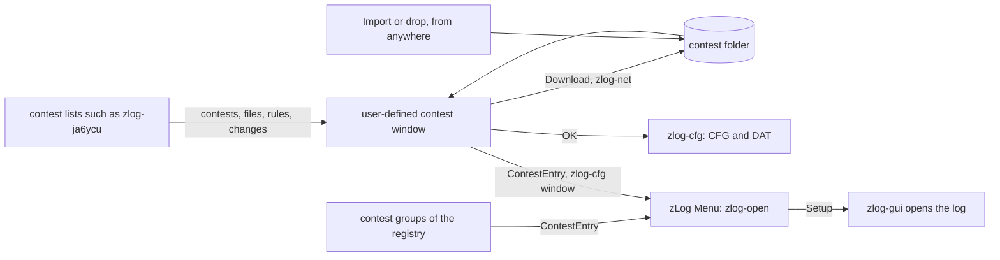
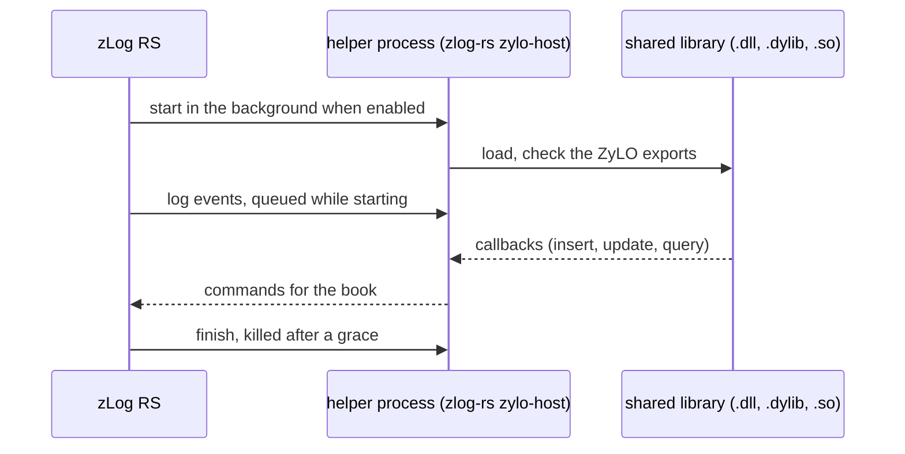
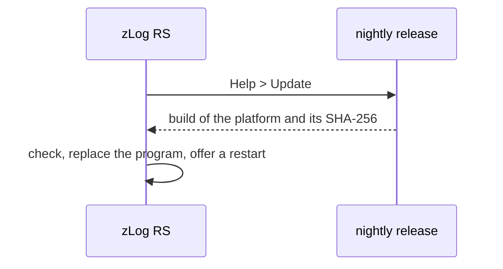
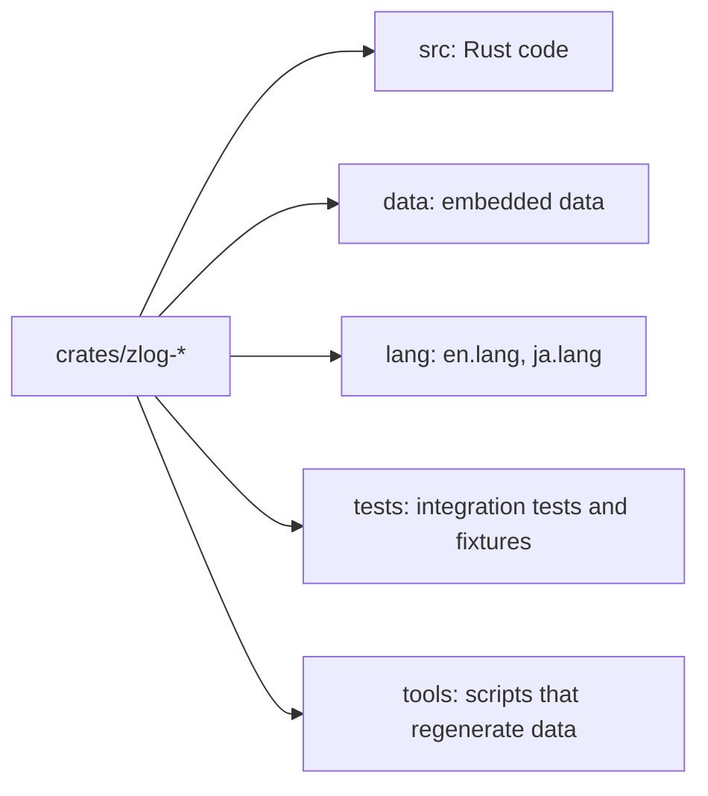

zLog RS
====


zLog RS is the contest logger zLog rewritten in Rust for macOS and Windows, based on [jr8ppg/zLog](https://github.com/jr8ppg/zLog).
Its core is small, and every contest, file format, window and device is an extension crate linked in at build time.

## Architecture



## Extensions



### Log changes



### Menus, toolbar and Options



### Rig control



### Logs and submission files



### User-defined contests



### ZyLO extensions



### Updates



### Crate layout



## Download

Builds of master for macOS and Windows are on the [nightly release](https://github.com/nextzlog/zlog-rs/releases/tag/nightly).
The manual is at [use.zlog.org](https://use.zlog.org).

## Build

```sh
$ cargo build --release -p zlog-gui
$ ./target/release/zlog-gui
```

Each extension is a Cargo feature of `zlog-gui`.

## Test

```sh
$ cargo test --workspace
```

## License

### Author

[無線部開発班](https://nextzlog.dev)

### Clauses

- This software is released under the [MIT License](LICENSE).
- The toolbar icons are [Phosphor Icons](https://phosphoricons.com) (MIT, Copyright (c) 2023 Phosphor Icons), embedded in zlog-ui with codepoints from [egui-phosphor](https://github.com/amPerl/egui-phosphor) (MIT OR Apache-2.0, Copyright (c) 2023 Romet Tagobert); see [crates/zlog-ui/LICENSE](crates/zlog-ui/LICENSE).
