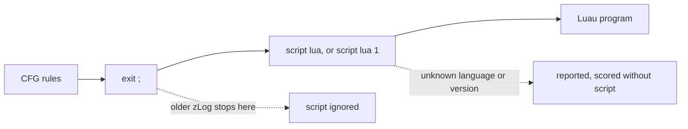
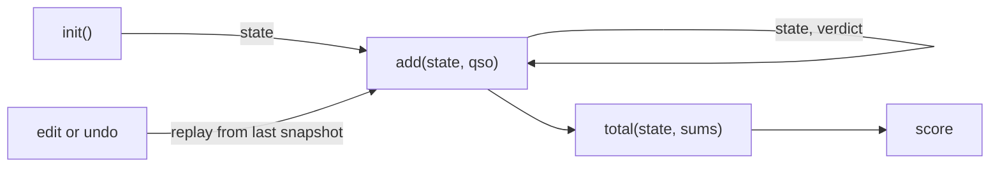
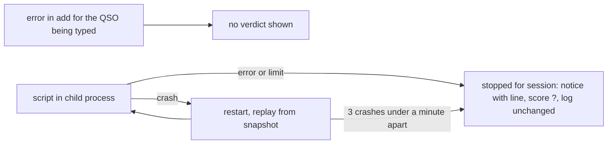

Scoring scripts in Lua for user-defined contests (CFG), API version 1.

## Place

- Write `script lua` on the line after `exit ;`, then the Luau program.
- `script lua 1` names the API version; the default is 1.

## Callbacks

| Function | Called | Returns | Closest in ZyLO |
| --- | --- | --- | --- |
| `init()` | at the start of scoring | the state (a table) | OnAttachEvent / OnAssignEvent |
| `add(state, qso)` | for each QSO, in log order | the state, a verdict | OnInsertEvent with OnAcceptEvent |
| `total(state, sums)` | at the end | the score (an integer) | OnPointsEvent(score, mults) |

## State

- zLog owns the state.
- There is no delete callback.
- Globals, chunk-level locals and tables they reach are read-only.
- Allowed values: `nil`, booleans, finite numbers, UTF-8 strings, tables.
- Tables may be shared or contain themselves.
- No metatables.
- No tables reached from a global or chunk-level local (including `string`, `zlog.bands`).
- A violation is reported as an error after `add`.
- The order of `pairs` is not fixed.
- `total` cannot change the state.

## qso (Read-Only)

| Field | Type | Meaning |
| --- | --- | --- |
| `call` | string | callsign worked |
| `sent` / `rcvd` | string | number sent / received |
| `name` / `note` | string | operator / memo |
| `band` | string | zLog band name: `1.9` `3.5` `7` `10` `14` `18` `21` `24` `28` `50` `144` `430` `1200` `2400` `5600` `10.1G` `10.4G` `24G` `47G` `77G` `135G` `248G` |
| `mode` | string | `CW` `SSB` `FM` `AM` `RTTY` `FT4` `FT8` `Other` `DV` |
| `srst` / `rrst` | integer | RST sent / received |
| `tx` | integer | transmitter number |
| `time` | string | time as logged, `YYYY-MM-DDThh:mm:ss` |
| `dupe` | boolean | a dupe |
| `counted` | boolean | on a contest band and not marked invalid; if false the verdict is unused |

## Verdict and Total

| Value | Form |
| --- | --- |
| verdict | `{score = integer, mul1 = string, mul2 = string}` |
| invalid QSO | `{invalid = "reason"}` |
| `sums` | `{score = sum of points, mults = multipliers, qsos = QSOs}` |

- Missing fields default to 0 or the empty string; unknown fields are ignored.
- `mul1` is looked up in the DAT multipliers and counted per band.
- A non-empty `mul2` counts on every QSO.
- Neither may hold control characters.

## zlog (Read-Only)

- `zlog.api` is 1.
- `zlog.bands` and `zlog.modes` list the names above in zLog's order.

## Limits and Failures

- No `os`, `io`, `require`, `load`, `print`, randomness or clock.
- Memory, instructions and call depth are limited.
- The same log always gives the same result.

## Compatibility

- The API only grows: new qso fields, optional callbacks, zlog values.
- Nothing is renamed, removed or retyped; older versions keep working.
